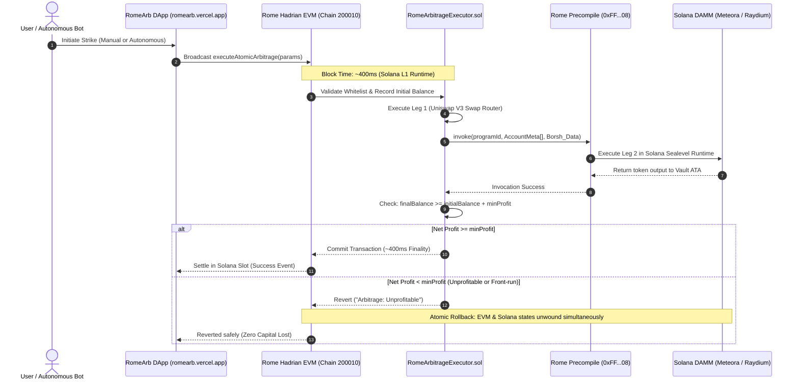

# RomeArb — Dual-VM Atomic Arbitrage Architecture

---

## Technical Specifications
- **Single-State Paradigm:** EVM and Solana read and write the exact same underlying state machine. No custodial bridge, no wrapped debt tokens.
- **Maximum CPI Depth:** 4 levels (strict adherence to Solana Sealevel limits).
- **Instruction Data Format:** Borsh binary serialized buffers with 1-byte discriminators and little-endian integers.
- **Gas Token:** USDC on Hadrian Testnet, ROME on Rubicon Mainnet.
